# AttendAI


**Anti-proxy class attendance: students check in with a face scan on their own phone, and the server verifies the face and the campus location.**

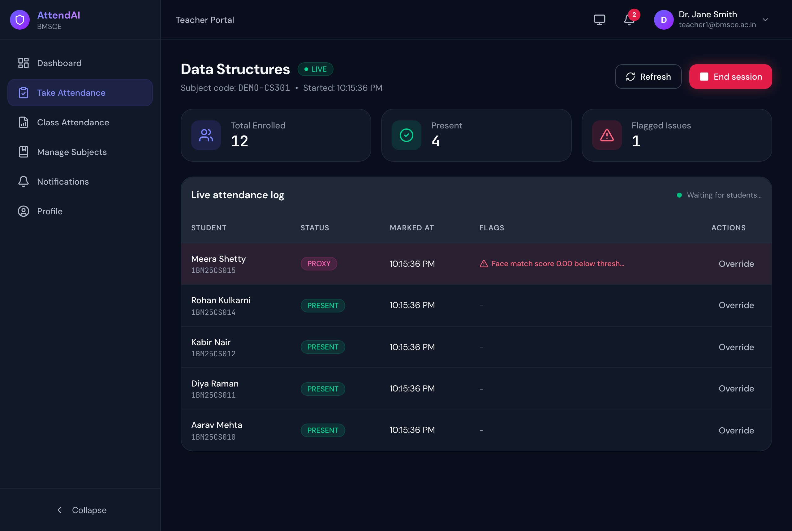

---

## Contents

- [Overview](#overview)
- [Screenshots](#screenshots)
- [Features](#features)
- [Tech stack](#tech-stack)
- [Architecture](#architecture)
- [Project structure](#project-structure)
- [Getting started](#getting-started)
- [Configuration](#configuration)
- [Running in development and production](#running-in-development-and-production)
- [Usage walkthrough](#usage-walkthrough)
- [Scripts](#scripts)
- [API reference](#api-reference)
- [Testing](#testing)
- [Linting and formatting](#linting-and-formatting)
- [Deployment](#deployment)
- [Design system and accessibility](#design-system-and-accessibility)
- [Troubleshooting and FAQ](#troubleshooting-and-faq)
- [Security notes and known limitations](#security-notes-and-known-limitations)
- [Roadmap ideas](#roadmap-ideas)
- [Contributing](#contributing)
- [License](#license)

## Overview

**The problem.** Proxy attendance means one student answers the roll call, or signs the sheet, for a friend who is absent. Roll calls also eat into class time, and paper registers have to be typed up before anyone can see who is falling behind.

**What AttendAI does.** A teacher opens an attendance session for a class. For the next few minutes, each enrolled student checks in from their own device:

1. The browser captures a frame from the camera and turns the face into a 128-number _descriptor_ with [face-api.js](https://github.com/justadudewhohacks/face-api.js).
2. The browser sends that descriptor and the phone's GPS position to the API.
3. The **server** compares the descriptor with the student's enrolled face samples and checks the location against the campus geofence. It then records the student as present, late or `proxy_detected`.

The teacher watches check-ins arrive live, and proxy attempts are flagged for review. When the session closes, students who never checked in are marked absent and notified. Students below the minimum attendance get an alert.

**Who it is for.** Colleges that want a lightweight, self-hosted attendance system. There are three roles:

- **Students** check in and track their own attendance.
- **Teachers** run sessions, review flags and export class attendance.
- **Administrators** manage accounts and campus-wide rules.

The project was built for BMS College of Engineering (BMSCE). The campus coordinates, email domain and demo data reflect that. The campus location, radius and thresholds can be changed in the admin settings.

## Screenshots

All screenshots were taken from the running app using the demo data from `npm run db:seed` and `npm run db:seed:demo`. Every name in them is fictional. The app has a dark theme and a light theme, and follows the operating system setting by default.

| Sign in                                          | Student dashboard                                                 |
| ------------------------------------------------ | ----------------------------------------------------------------- |
| 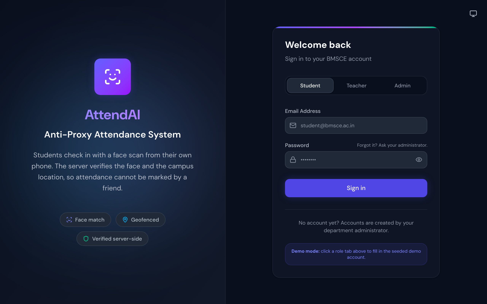 | 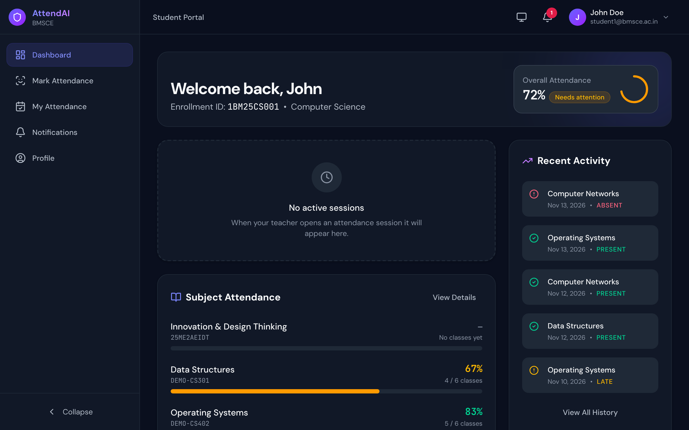 |

| Mark attendance (student without an enrolled face)                 | Teacher dashboard (light theme)                                    |
| ------------------------------------------------------------------ | ------------------------------------------------------------------ |
| 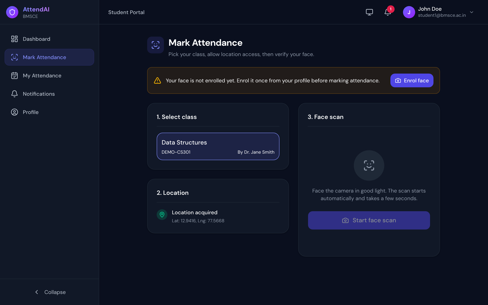 | 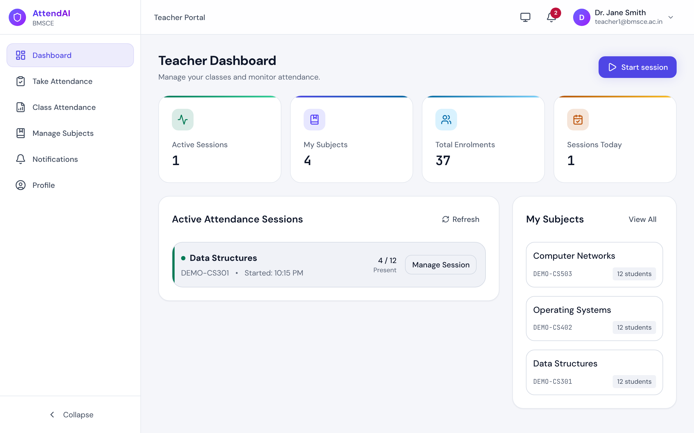 |

| Class attendance with CSV export                                       | Admin student directory                                         |
| ---------------------------------------------------------------------- | --------------------------------------------------------------- |
| 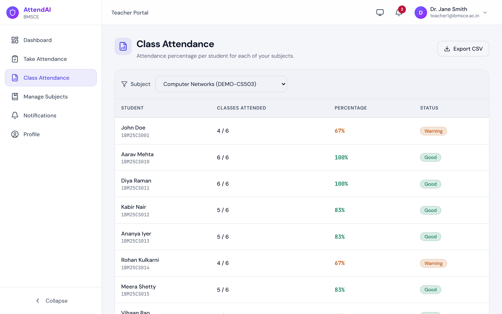 | 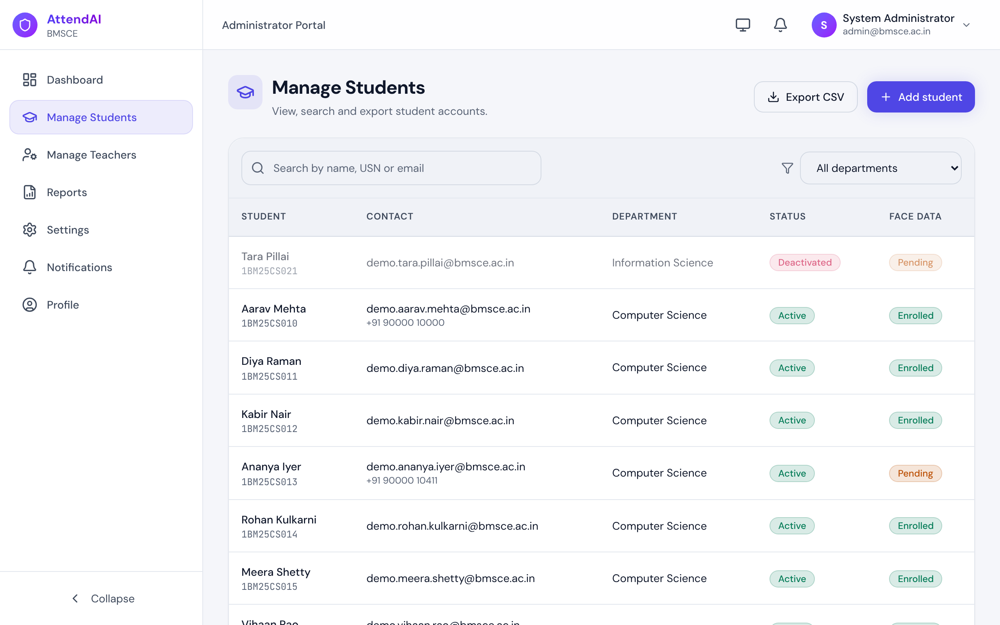 |

| System settings                                               |
| ------------------------------------------------------------- |
| 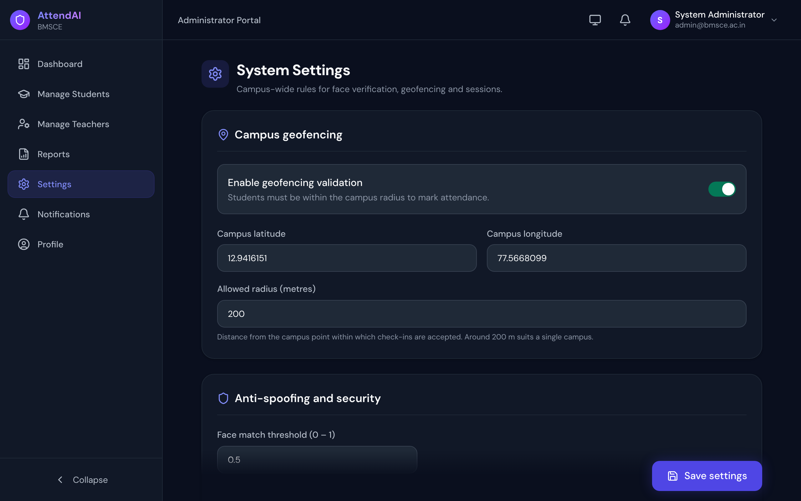 |

**On a phone (390 px wide):**

| Student dashboard                                                      | Navigation drawer                                                 | Notifications                                                           |
| ---------------------------------------------------------------------- | ----------------------------------------------------------------- | ----------------------------------------------------------------------- |
| 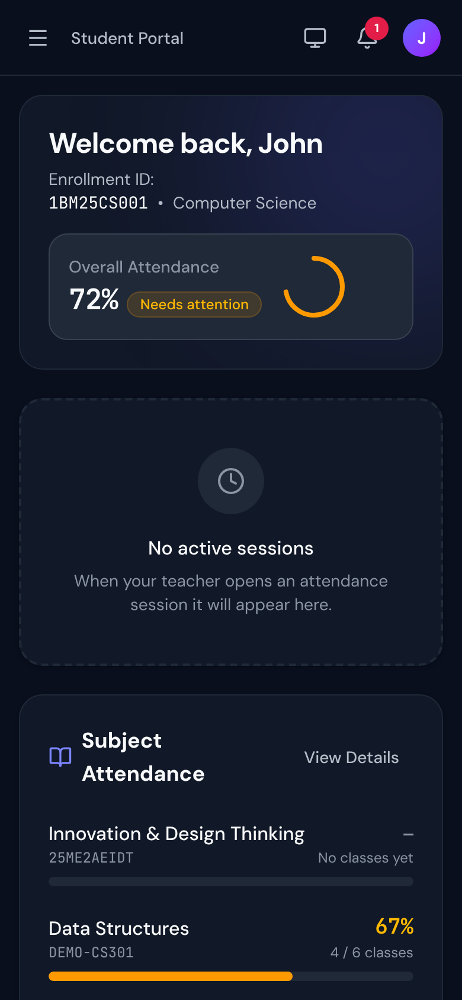 | 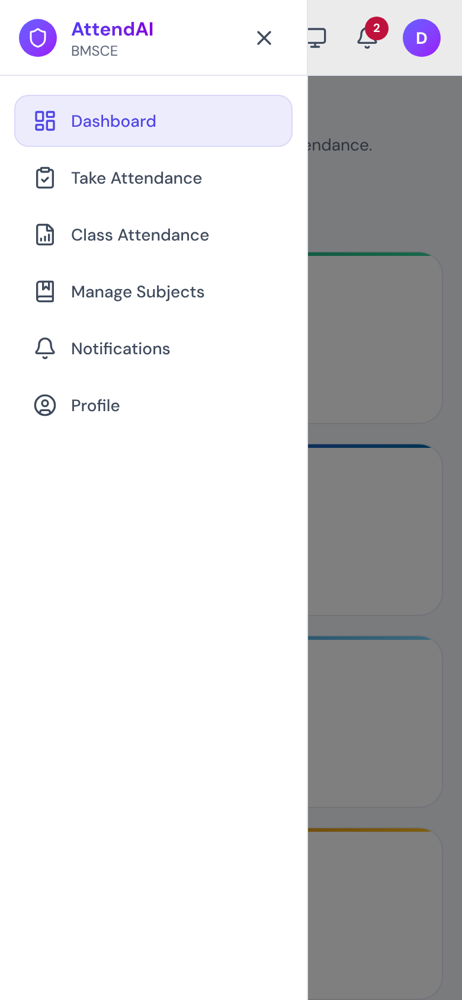 | 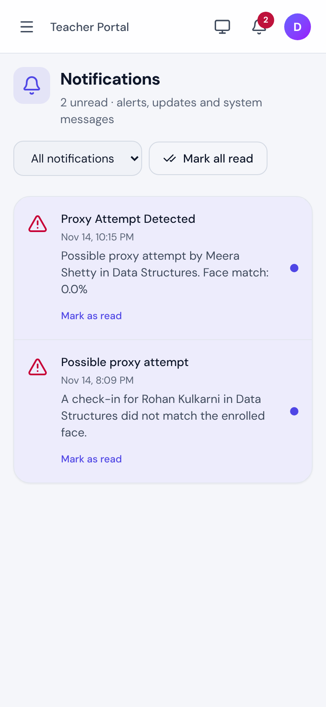 |

## Features

### Students

- **Face enrolment.** Enrol once from **Profile**. The app captures 5 samples from the webcam, and only the descriptors (not images) are sent to the server.
- **Check-in.** **Mark Attendance** walks through three steps: pick the open session, allow location access, then run a face scan. The scan starts on its own once the camera is ready. If the face is not enrolled yet, a banner links straight to the profile page.
- **Dashboard.** Shows overall and per-subject attendance percentages with colour-coded progress bars (green ≥ 75 %, amber ≥ 65 %, red below). It also shows recent activity and a call to action whenever a session is open.
- **History.** **My Attendance** lists every record with status, verification method and match score, and can be filtered by subject.
- **Notifications.** Absent alerts, low-attendance warnings and system messages. They can be filtered to unread and marked as read one at a time or all at once.

### Teachers

- **Subjects.** Create subjects and enrol students by pasting USNs or emails, separated by commas or new lines. Identifiers that do not match a student are reported back.
- **Live sessions.** Start a session for a subject and watch check-ins arrive in real time over Server-Sent Events. Live counters show enrolled, present and flagged students.
- **Overrides.** Change any record to present, late or absent. A reason is required and stored with the record.
- **Ending a session.** A confirmation dialog explains that students who have not checked in will be marked absent. Sessions also close automatically when the attendance window expires.
- **Class attendance.** Per-student percentages for each subject, with Good, Warning and Critical badges and **CSV export**.
- **Dashboard.** Active sessions, number of subjects, total enrolments and sessions started today.

### Administrators

- **Directories.** Searchable student and teacher lists, filterable by department, with **CSV export**.
- **Registering users.** Create student, teacher or admin accounts. A random temporary password is generated for each one.
- **System settings.** Every setting is validated in the browser before it is saved:
  - campus geofence: on/off, centre and radius
  - face-match threshold
  - attendance window
  - late threshold
  - minimum attendance percentage
- **Dashboard.** Total students and teachers, today's attendance rate and today's proxy attempts.

### Anti-proxy checks (enforced by the API)

- **Server-side face matching.** The API computes the euclidean distance between the live descriptor and each enrolled sample. It turns the best distance into a score and compares that with the configured threshold. A client cannot submit its own match score.
- **Geofencing.** The haversine distance from the campus centre must be within the configured radius. Check-ins from outside it are marked `proxy_detected`. A check-in with no location is accepted but flagged for review.
- **Time window.** Check-ins are accepted only while the session is open and within the attendance window. Students who check in after the late threshold are marked `late`.
- **One check-in per student per session**, enforced by a database unique constraint (the API returns `409`).
- **Notifications.** Teachers are notified of proxy attempts. Absent students are notified when a session closes.

### Interface

- A responsive layout for phones, tablets and desktops. On phones the sidebar becomes an off-canvas drawer and tables become stacked cards.
- Light, dark and system themes, applied before first paint so the page never flashes the wrong theme.
- Loading, empty, error (with retry) and success states on every data view.
- Keyboard and screen-reader support. See [Design system and accessibility](#design-system-and-accessibility).

## Tech stack

| Layer         | Technology                                                                                              |
| ------------- | ------------------------------------------------------------------------------------------------------- |
| Frontend      | React 19, TypeScript, Vite 8, Tailwind CSS v4, React Router 7, Zustand, date-fns, lucide-react icons    |
| Notifications | react-hot-toast                                                                                         |
| Face AI       | face-api.js in the browser (TinyFaceDetector, 68-point landmarks, FaceRecognitionNet)                   |
| Backend       | Node.js ≥ 20.19, Express 5, TypeScript run with `tsx`, Zod validation, JWT auth, bcrypt                 |
| Real time     | Server-Sent Events (`/api/sse/session/:id`)                                                             |
| Database      | PostgreSQL through Drizzle ORM: Neon's serverless HTTP driver for `*.neon.tech`, `pg` for anything else |
| Jobs          | node-cron: rotates session tokens and closes expired sessions                                           |
| Tooling       | Vitest, Supertest, ESLint (typescript-eslint, react-hooks), Prettier, GitHub Actions                    |
| Hosting       | Vercel for the SPA (`vercel.json`) and any Node host for the API (the project has run on Railway)       |

## Architecture

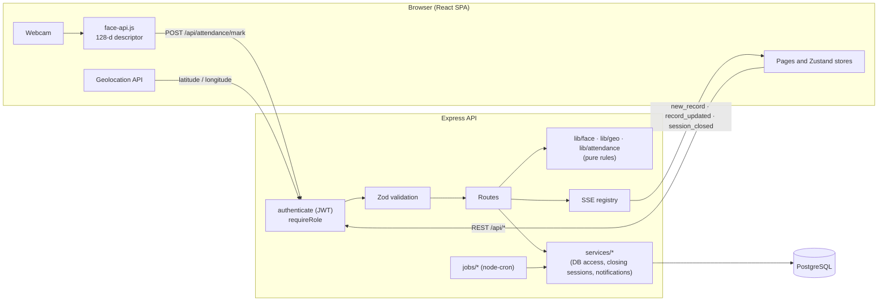

### How a check-in is processed

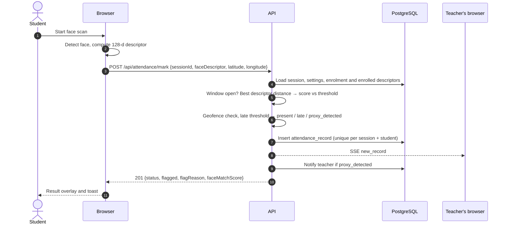

The attendance rules live in `server/lib` as pure functions with no I/O, so they are unit tested directly. Routes stay thin: they authorise, validate, load data, call the rules and persist the result.

**Data model:** `users`, `subjects`, `subject_enrollments`, `attendance_sessions`, `attendance_records`, `notifications`, `system_settings` (a single `global` row) and `audit_logs`. See [`server/db/schema.ts`](server/db/schema.ts).

## Project structure

```
.
├── .github/workflows/ci.yml     CI: lint, format, typecheck, test, build, then a Postgres smoke test
├── docs/screenshots/            Screenshots used in this README (captured from the running app)
├── index.html                   SPA shell: meta and Open Graph tags, fonts, no-flash theme script
├── public/
│   ├── favicon.svg
│   └── models/                  face-api.js weights, served statically and loaded only on camera pages
├── server/
│   ├── app.ts                   Express app factory: CORS, JSON body limit, routes, error handler
│   ├── index.ts                 Entry point: HTTP listener, cron jobs, graceful shutdown
│   ├── config/env.ts            Zod-validated environment configuration
│   ├── db/
│   │   ├── schema.ts            Drizzle table definitions
│   │   ├── connection.ts        Neon HTTP driver or node-postgres, chosen from DATABASE_URL
│   │   ├── seed.ts              Settings and the base demo admin/teacher/student/subject (idempotent)
│   │   ├── seedDemo.ts          Fictional demo data for screenshots and local testing (dev only)
│   │   └── clearData.ts         Deletes sessions, records, notifications and audit logs
│   ├── http/                    Error classes and handler, request schemas
│   ├── jobs/                    tokenRefresh.ts, sessionCleanup.ts
│   ├── lib/                     face.ts, geo.ts, attendance.ts (pure, unit-tested rules)
│   ├── middleware/              auth.ts (JWT), rbac.ts (roles and ownership)
│   ├── routes/                  auth, users, subjects, sessions, attendance, notifications, settings, sse
│   └── services/                Database-backed business logic
├── src/
│   ├── main.tsx                 Router, lazy-loaded routes, toaster, page titles
│   ├── index.css                Design tokens (dark and light), component classes
│   ├── api/client.ts            Axios instance, JWT interceptor, getErrorMessage()
│   ├── components/
│   │   ├── admin/UserDirectory  Shared student/teacher directory with search, filter and CSV export
│   │   ├── common/              ErrorBoundary, ThemeToggle
│   │   ├── layout/              Layout, Navbar, Sidebar (desktop rail and mobile drawer)
│   │   └── ui/                  Button, Card, Badge, Modal, Table, PageHeader, EmptyState,
│   │                            ErrorState, StatCard, LoadingSpinner
│   ├── hooks/                   useFaceRecognition, useSSE, useAttendance, useMediaQuery, useDocumentTitle
│   ├── lib/                     csv.ts, theme.ts, settingsValidation.ts (pure, unit-tested helpers)
│   ├── pages/                   auth/, student/, teacher/, admin/, shared/ (Profile, Notifications, 404)
│   ├── store/                   Zustand stores: auth, attendance, theme
│   └── types/                   Shared frontend types
├── tests/
│   ├── server/                  Geofence, face matching, attendance rules, validation, HTTP and RBAC tests
│   └── web/                     API error messages, CSV, theme and settings-validation helpers
├── drizzle.config.ts
├── eslint.config.js
├── vercel.json                  SPA rewrite for client-side routing
└── vite.config.ts               React and Tailwind plugins; dev proxy /api → localhost:3001
```

## Getting started

### Prerequisites

- **Node.js 20.19 or newer** (22 recommended) and npm.
- **PostgreSQL 14+.** A free [Neon](https://neon.tech) project works, as does a local Postgres such as `docker run -e POSTGRES_PASSWORD=postgres -p 5432:5432 postgres:16`.
- **A webcam**, and the app served from `localhost` or HTTPS. Browsers only allow camera and geolocation access on secure origins.

### Installation

```bash
# 1. Clone and install
git clone https://github.com/jeevithg090/Attendance-AI.git
cd Attendance-AI
npm install

# 2. Configure
cp .env.example .env
#    Set DATABASE_URL, and a JWT_SECRET of at least 32 characters, for example:
node -e "console.log(require('crypto').randomBytes(48).toString('base64'))"

# 3. Create the tables and seed the base demo accounts
npm run db:push
npm run db:seed

# 4. (Optional) add fictional demo students, subjects and two weeks of attendance history
npm run db:seed:demo

# 5. Start the frontend (port 5173) and the API (port 3001)
npm run dev
```

Open <http://localhost:5173>. In development, Vite proxies `/api` to `localhost:3001`, so `VITE_API_URL` can stay empty.

### Demo accounts

Created by `npm run db:seed` when `NODE_ENV` is not `production`:

| Role    | Email                  | Password      |
| ------- | ---------------------- | ------------- |
| Admin   | `admin@bmsce.ac.in`    | `Admin@123`   |
| Teacher | `teacher1@bmsce.ac.in` | `Teacher@123` |
| Student | `student1@bmsce.ac.in` | `Student@123` |

`npm run db:seed:demo` adds the following, all with the password `Demo@1234`:

- 12 fictional students (`demo.*@bmsce.ac.in`), one of them deactivated
- a second teacher
- three subjects owned by `teacher1`
- 18 closed sessions spread over the last two weeks, with present, late, absent and proxy records
- a few notifications

Re-running it replaces the previous demo data, and it refuses to run when `NODE_ENV=production`.

> Most demo students are marked as face-enrolled with **synthetic** descriptors. No real face will match them, so they are useful for testing check-ins through the API but not with a camera. For a real scan, sign in as `student1` and enrol your own face from **Profile**.

Set `VITE_SHOW_DEMO_LOGINS=true` to make the role tabs on the sign-in page fill in these credentials.

## Configuration

The API reads `.env` through `dotenv` and validates it with Zod at startup (`server/config/env.ts`). It refuses to start with a clear message if a value is invalid. Vite reads the `VITE_*` variables from the same file at build time.

| Variable                | Required          | Default       | Description                                                                                                 |
| ----------------------- | ----------------- | ------------- | ----------------------------------------------------------------------------------------------------------- |
| `DATABASE_URL`          | **yes**           | –             | Postgres connection string. Hosts ending in `.neon.tech` use the Neon HTTP driver; all others use `pg`.     |
| `JWT_SECRET`            | **yes**           | –             | Secret used to sign JWTs. Must be at least 32 characters.                                                   |
| `JWT_EXPIRES_IN`        | no                | `7d`          | Token lifetime in `jsonwebtoken` format (`12h`, `7d`, ...).                                                 |
| `PORT`                  | no                | `3001`        | Port the API listens on.                                                                                    |
| `NODE_ENV`              | no                | `development` | `production` removes the localhost CORS origins and requires `SEED_*_PASSWORD` for seeding.                 |
| `FRONTEND_URL`          | in production     | empty         | Comma-separated origins allowed by CORS, e.g. `https://your-app.vercel.app`.                                |
| `TRUST_PROXY`           | no                | `0`           | Number of reverse proxies in front of the API, so `req.ip` is correct. Use `1` on Railway, Render or Fly.   |
| `ENABLE_CRON`           | no                | `true`        | Set to `false` to disable token rotation and automatic closing of expired sessions.                         |
| `SEED_ADMIN_PASSWORD`   | in production     | `Admin@123`   | Password for the seeded admin account.                                                                      |
| `SEED_TEACHER_PASSWORD` | in production     | `Teacher@123` | Password for the seeded teacher account.                                                                    |
| `SEED_STUDENT_PASSWORD` | in production     | `Student@123` | Password for the seeded student account.                                                                    |
| `VITE_API_URL`          | for split deploys | `/api`        | API base URL baked into the frontend build, e.g. `https://api.example.com/api`.                             |
| `VITE_APP_NAME`         | no                | `AttendAI`    | App name used in page titles.                                                                               |
| `VITE_SHOW_DEMO_LOGINS` | no                | `false`       | `true` makes the role tabs on the sign-in page fill in the demo credentials. Use only for demo deployments. |

> Do not set `NODE_ENV` in a local `.env`. Vite reads that file too, and `NODE_ENV=development` there produces an unminified frontend build.

**Runtime settings** such as the face-match threshold, attendance window, late threshold, minimum attendance and geofence are not environment variables. They live in the `system_settings` table and are edited in the app under **Settings** (admin).

| Setting              | Default                | Effect                                                                       |
| -------------------- | ---------------------- | ---------------------------------------------------------------------------- |
| Face match threshold | `0.5`                  | Check-ins scoring below this are recorded as `proxy_detected`.               |
| Attendance window    | `30` min               | Check-ins are rejected after this, and the cron job closes the session.      |
| Late threshold       | `10` min               | Check-ins after this are recorded as `late`.                                 |
| Minimum attendance   | `75` %                 | Students below this get a low-attendance notification when a session closes. |
| Geofencing           | on, 200 m around BMSCE | Check-ins outside the radius are recorded as `proxy_detected`.               |

## Running in development and production

**Development**

```bash
npm run dev            # Vite with hot reload on :5173 + API with tsx watch on :3001
npm run dev:frontend   # only the SPA
npm run dev:backend    # only the API
```

**Production (single machine)**

```bash
npm ci
npm run build          # typecheck frontend and server, then build the SPA into dist/
NODE_ENV=production npm start   # starts the API; serve dist/ with any static host or CDN
npm run preview        # optional: serve the built SPA locally on :4173 to check the build
```

The API does not serve the SPA. Host `dist/` on a static host such as Vercel, Netlify or nginx, set `VITE_API_URL` at build time, and add the frontend origin to `FRONTEND_URL`.

## Usage walkthrough

The full flow from scratch, using the demo accounts:

1. **Student: enrol a face.** Sign in as `student1@bmsce.ac.in`, open **Profile → Enroll Face Data Now**, allow the camera and press **Start Capture**. Five samples are captured and sent to `POST /api/users/:id/face-descriptors`.
2. **Teacher: start a session.** Sign in as `teacher1@bmsce.ac.in`, open **Take Attendance**, pick a subject and press **Start session now**. The page switches to the live view.
3. **Student: check in.** Back as the student, open **Mark Attendance**. Select the open session, allow location access and press **Start face scan**. The result (present, late or flagged) appears on screen, and a banner links to your history.
4. **Teacher: review.** The check-in appears in the live log without a refresh. Use **Override** to correct a record (a reason is required) and **End session** to close it. Students who did not check in are then marked absent.
5. **Teacher: report.** **Class Attendance** shows each student's percentage for a subject. Press **Export CSV** to download it.
6. **Admin: tune the rules.** Sign in as `admin@bmsce.ac.in` and open **Settings**. To test from off campus, turn geofencing off or move the campus centre to where you are.

### Calling the API directly

All responses use the envelope `{ "success": boolean, "data"?: ..., "error"?: string }`. Send the token as `Authorization: Bearer <token>`.

**Sign in**

```bash
curl -s http://localhost:3001/api/auth/login \
  -H 'Content-Type: application/json' \
  -d '{"email":"student1@bmsce.ac.in","password":"Student@123"}'
```

```json
{
  "success": true,
  "data": {
    "token": "eyJhbGciOi...",
    "user": {
      "id": "dcb47acf-4cfd-4b00-8850-f8c435ba4e58",
      "email": "student1@bmsce.ac.in",
      "displayName": "John Doe",
      "role": "student",
      "department": "Computer Science",
      "enrollmentId": "1BM25CS001",
      "faceEnrolled": false,
      "faceDescriptorCount": 0,
      "isActive": true
    }
  }
}
```

A wrong password returns `401` with `{"success":false,"error":"Invalid credentials"}`. Raw face descriptors are never returned by any endpoint.

**List open sessions (student)**

```bash
curl -s http://localhost:3001/api/sessions/active -H "Authorization: Bearer $TOKEN"
```

```json
{
  "success": true,
  "data": [
    {
      "id": "e9c86b9f-3a68-4be4-9ba9-8b26ba7b6f6c",
      "subjectName": "Data Structures",
      "subjectCode": "DEMO-CS301",
      "teacherName": "Dr. Jane Smith",
      "status": "active",
      "startTime": "2026-11-14T22:15:36.183Z",
      "totalEnrolled": 12,
      "totalPresent": 4
    }
  ]
}
```

(Abridged. Students never receive the rotating `sessionToken`.)

**Mark attendance (student)**

```bash
curl -s http://localhost:3001/api/attendance/mark \
  -H "Authorization: Bearer $TOKEN" -H 'Content-Type: application/json' \
  -d '{"sessionId":"e9c86b9f-...","faceDescriptor":[0.012,-0.087, ... 128 numbers],"latitude":12.9416,"longitude":77.5668}'
```

On success the API returns `201` with the stored record, for example `"status": "present"`, `"faceMatchScore": 0.91`, `"faceMatchThreshold": 0.5`, `"flagged": false`. A second attempt for the same session returns `409` with `{"success":false,"error":"Attendance already marked for this session"}`.

## Scripts

| Command                | What it does                                                              |
| ---------------------- | ------------------------------------------------------------------------- |
| `npm run dev`          | Frontend (Vite) and API (`tsx watch`) together via `concurrently`         |
| `npm run dev:frontend` | Vite dev server only                                                      |
| `npm run dev:backend`  | API only, restarting on changes                                           |
| `npm run build`        | `typecheck`, then `vite build` into `dist/`                               |
| `npm run preview`      | Serve the production build locally                                        |
| `npm start`            | Run the API (`tsx server/index.ts`)                                       |
| `npm test`             | Run the Vitest suites once (no database needed)                           |
| `npm run test:watch`   | Vitest in watch mode                                                      |
| `npm run typecheck`    | `tsc` for the frontend and the server configs                             |
| `npm run lint`         | ESLint over the whole repo                                                |
| `npm run format`       | Prettier write (`npm run format:check` to verify only)                    |
| `npm run db:push`      | Sync the Drizzle schema to the database                                   |
| `npm run db:generate`  | Generate SQL migrations into `drizzle/migrations`                         |
| `npm run db:migrate`   | Apply generated migrations                                                |
| `npm run db:seed`      | Seed global settings and the base demo accounts (idempotent)              |
| `npm run db:seed:demo` | Add fictional demo students, subjects and history (dev only, re-runnable) |
| `npm run db:clear`     | Delete sessions, records, notifications and audit logs (keeps users)      |
| `npm run db:studio`    | Open Drizzle Studio                                                       |

## API reference

Base path: `/api`. "Auth" lists the roles allowed. "Any" means any signed-in user. Ownership checks apply on top of roles: for example, teachers can only manage their own subjects and sessions, and students can only read their own records.

| Method | Path                                   | Auth                       | Description                                                            |
| ------ | -------------------------------------- | -------------------------- | ---------------------------------------------------------------------- |
| GET    | `/health`                              | public                     | Liveness check with uptime                                             |
| POST   | `/auth/login`                          | public                     | Exchange email and password for a JWT and the user profile             |
| POST   | `/auth/register`                       | admin                      | Create a user account                                                  |
| GET    | `/auth/me`                             | any                        | Current user                                                           |
| PUT    | `/auth/profile`                        | any                        | Update own display name, phone or photo URL                            |
| GET    | `/users`                               | admin, teacher             | List users (`role`, `department`, `search`, `limit` filters)           |
| POST   | `/users/bulk-import`                   | admin                      | Create several users at once                                           |
| GET    | `/users/:id`                           | self, teacher, admin       | Get a user                                                             |
| PUT    | `/users/:id`                           | admin                      | Update a user                                                          |
| DELETE | `/users/:id`                           | admin                      | Deactivate a user (soft delete)                                        |
| POST   | `/users/:id/face-descriptors`          | self, admin                | Enrol face descriptors (1–20 × 128 numbers)                            |
| GET    | `/subjects`                            | any                        | List subjects                                                          |
| GET    | `/subjects/my-subjects`                | teacher, admin             | Teacher's own subjects with enrolment counts (admins see all)          |
| GET    | `/subjects/enrolled`                   | student                    | The student's subjects                                                 |
| GET    | `/subjects/:id`                        | any                        | Get a subject                                                          |
| POST   | `/subjects`                            | teacher, admin             | Create a subject                                                       |
| PUT    | `/subjects/:id`                        | teacher (owner), admin     | Update a subject                                                       |
| POST   | `/subjects/:id/enroll`                 | teacher (owner), admin     | Enrol students by ID                                                   |
| GET    | `/subjects/:id/students`               | teacher (owner), admin     | Enrolled students                                                      |
| GET    | `/sessions`                            | teacher, admin             | Sessions (teachers see their own; `status`, `subjectId`, `limit`)      |
| GET    | `/sessions/active`                     | student                    | Open sessions for the student's subjects (no session token)            |
| POST   | `/sessions`                            | teacher, admin             | Start a session for a subject                                          |
| POST   | `/sessions/:id/close`                  | teacher (owner), admin     | Close a session and mark absentees (idempotent)                        |
| GET    | `/sessions/:id`                        | any, with ownership checks | Get a session                                                          |
| POST   | `/attendance/mark`                     | student                    | Check in with `faceDescriptor` and optional `latitude`/`longitude`     |
| POST   | `/attendance/override`                 | teacher, admin             | Change a record's status with a reason                                 |
| GET    | `/attendance/session/:sessionId`       | teacher, admin             | All records for a session                                              |
| GET    | `/attendance/student/:studentId`       | self, teacher, admin       | A student's history (`subjectId` filter)                               |
| GET    | `/attendance/subject/:subjectId/stats` | teacher, admin             | Per-student percentages for a subject                                  |
| GET    | `/attendance/dashboard/stats`          | admin                      | Campus-wide dashboard numbers                                          |
| GET    | `/attendance/my-stats`                 | student                    | Student dashboard data                                                 |
| GET    | `/notifications`                       | any                        | Own notifications (`unreadOnly=true`) and unread count                 |
| PUT    | `/notifications/read-all`              | any                        | Mark all own notifications as read                                     |
| PUT    | `/notifications/:id/read`              | any (owner)                | Mark one notification as read                                          |
| GET    | `/settings`                            | any                        | Read system settings                                                   |
| PUT    | `/settings`                            | admin                      | Update settings (strict whitelist with range checks)                   |
| GET    | `/settings/audit-logs`                 | admin                      | Recent audit log entries                                               |
| GET    | `/sse/session/:sessionId`              | teacher, admin             | Server-Sent Events stream for a live session (`?token=` accepted here) |

Validation errors return `400` with a message. Missing or invalid tokens return `401`, and role or ownership failures return `403`. Unknown routes under `/api` return `404`.

## Testing

```bash
npm test             # run once
npm run test:watch   # re-run on change
```

The 77 Vitest tests need no database:

- **`tests/server/geo.test.ts`**: haversine distance and geofence boundaries.
- **`tests/server/face.test.ts`**: descriptor distance, best-match selection and score conversion.
- **`tests/server/attendance.test.ts`**: present, late and proxy rules, missing-location flags and attended-status counting.
- **`tests/server/validation.test.ts`**: request schemas, including the settings whitelist.
- **`tests/server/app.test.ts`**: Supertest against the real Express app with an in-memory database stub (`fakeDb.ts`). Covers authentication, role and ownership checks, validation and the mark-attendance flow.
- **`tests/web/*.test.ts`**: API error messages, CSV escaping (including formula-injection protection), theme preference logic and settings-form validation.

The React components have no automated UI tests. The UI was checked by hand with Playwright: every page for all three roles, at 375, 768 and 1280 px wide, in both themes. The checks looked for console errors, failed API calls and horizontal scrolling.

**CI.** `.github/workflows/ci.yml` runs lint, format check, typecheck, tests and the production build on pushes to `main` and on pull requests. A second job then starts Postgres 16, pushes the schema, seeds it, boots the API and checks `/api/health` and a real login.

## Linting and formatting

- **ESLint** (`eslint.config.js`): `@eslint/js` and `typescript-eslint` recommended rules, plus `react-hooks` for `src/`. `npm run lint` reports no errors. Four `exhaustive-deps` warnings remain on effects that are meant to run only on mount.
- **Prettier** (`.prettierrc.json`): 110-column lines and single quotes. Run `npm run format` before committing; CI runs `npm run format:check`.
- **TypeScript** runs in strict mode for both the SPA (`tsconfig.json`) and the server (`tsconfig.server.json`).

## Deployment

The frontend and the API deploy separately.

### API (Railway, Render, Fly.io or any Node host)

1. **Build command:** `npm ci`. The API runs TypeScript directly with `tsx`, so there is no compile step.
2. **Start command:** `npm start`.
3. **Environment variables:**
   - `DATABASE_URL`
   - `JWT_SECRET` (32+ characters)
   - `NODE_ENV=production`
   - `FRONTEND_URL=https://<your-frontend>`
   - `TRUST_PROXY=1`
4. **Database setup:** once, against the production database, run `npm run db:push`, then `npm run db:seed` with all three `SEED_*_PASSWORD` variables set. Do not run `db:seed:demo` in production; it refuses to.
5. **Scaling:** run a **single instance**, or set `ENABLE_CRON=false` on every instance but one. The cron jobs and the SSE client registry live in process memory.

### Frontend (Vercel)

1. Import the repository and choose the **Vite** preset. Use the build command `npx vite build` and the output directory `dist`.
2. Set `VITE_API_URL=https://<your-api-host>/api`. Leave `VITE_SHOW_DEMO_LOGINS` unset unless this is a public demo.
3. `vercel.json` rewrites every path to `index.html`, so deep links such as `/teacher/class-attendance` work.

Camera and geolocation require **HTTPS** in production. Both Vercel and Railway provide it by default.

## Design system and accessibility

The look is defined by CSS custom properties in [`src/index.css`](src/index.css), with a dark set on `:root` and a light set on `:root[data-theme='light']`. Components use these tokens instead of hard-coded colours.

- **Colour.** The tokens cover surfaces (`--bg-primary`, `--bg-surface`, `--bg-elevated`), text (`--text-primary`, `--text-secondary`, `--text-muted`), brand and status colours, and borders.
  - Text tokens were chosen to meet WCAG AA contrast (at least 4.5:1) on every surface in both themes.
  - Filled buttons use darker `*-solid` variants so white labels stay readable.
  - In the light theme, Tailwind's light status shades (for example `text-emerald-400`) are remapped to darker values, so status text stays readable on white.
- **Type and spacing.**
  - Fonts: DM Sans for the interface and JetBrains Mono for IDs and numbers.
  - Text sizes: page titles are `text-xl`/`text-2xl`, section titles `text-lg` and body text `text-sm`.
  - Spacing follows Tailwind's 4 px scale.
  - Corner radius comes from the 8, 12, 16 and 20 px `--radius-*` tokens.
- **Components.**
  - `PageHeader`, `Card`, `Button` (primary, secondary, outline, ghost, danger, success; 36–48 px tall touch targets) and `Badge`.
  - `Table`, which turns into stacked cards below 640 px.
  - `Modal`, `EmptyState`, `ErrorState`, `StatCard` and `LoadingSpinner` (with skeleton loaders).
- **Theme.** The navbar and sign-in page have a button that cycles system → light → dark. The choice is saved in `localStorage`, and a small inline script in `index.html` applies it before React loads.
- **Keyboard.**
  - A skip link jumps to the main content.
  - Focus outlines are visible everywhere.
  - Dialogs trap focus, close on <kbd>Esc</kbd> and return focus to the button that opened them.
  - The account menu and the mobile drawer close on <kbd>Esc</kbd>. The drawer is `inert` while hidden, so off-screen links are never focusable.
- **Screen readers.**
  - Page structure uses `header`, `nav`, `main` and `article`, with one `h1` per page.
  - Every form field has a label, and validation errors are linked through `aria-describedby` and `aria-invalid`.
  - Tables have captions and `scope="col"` headers.
  - Status updates use `aria-live`, and the toggles are proper `role="switch"` controls.
  - Icons are decorative (`aria-hidden`). Icon-only buttons have an `aria-label`.
- **Motion.** Animations are short and subtle. `prefers-reduced-motion` turns off animations, transitions and the stat count-up.
- **Performance.** Routes are lazy-loaded. The initial JS bundle is about 320 kB (105 kB gzipped). face-api.js and its model weights load only on the camera pages.

## Troubleshooting and FAQ

**The API exits with "Invalid environment configuration".**
`DATABASE_URL` is missing, or `JWT_SECRET` is shorter than 32 characters. The message lists each problem. Compare your `.env` with `.env.example`.

**The browser shows CORS errors in production.**
Add the exact frontend origin, with no trailing slash, to `FRONTEND_URL` on the API host, and redeploy. Localhost origins are only allowed when `NODE_ENV` is not `production`.

**Requests go to the wrong host, or return the SPA HTML instead of JSON.**
`VITE_API_URL` is baked in at build time. Set it on the frontend host (it must end in `/api`) and rebuild.

**The camera or location prompt never appears.**
Browsers block both on insecure origins. Use `http://localhost` or HTTPS, and check the site permissions in the browser's address bar. On phones, the OS may also need to allow the browser to use the camera and location.

**"No face detected".**
Use better, even lighting in front of you, move closer and look straight at the camera. The detector ignores very small faces as a basic anti-spoofing measure.

**Every check-in is flagged "Outside campus geofence".**
You are testing away from the configured campus. As admin, turn geofencing off, or set the campus latitude, longitude and radius to your location, in **Settings**.

**My scan is recorded as `proxy_detected` even though it is me.**
The match score fell below the threshold. Re-enrol your face from **Profile** in the lighting you normally check in under. An admin can also lower the threshold a little (for example to 0.45). Lower values make it easier for someone else to pass as you.

**"The attendance window for this session has closed".**
Check-ins are only accepted for the configured number of minutes after the session starts. A teacher can start a new session, or an admin can widen the window.

**The live log does not update.**
SSE connections can be cut by proxies that buffer responses. Use **Refresh** to reload the log. If you run several API instances, live updates only reach teachers connected to the same instance (see [Deployment](#deployment)).

**`npm run db:seed` fails in production.**
That is intentional: set `SEED_ADMIN_PASSWORD`, `SEED_TEACHER_PASSWORD` and `SEED_STUDENT_PASSWORD` first.

**How do I reset local data?**
`npm run db:clear` removes sessions, records, notifications and audit logs and keeps users and subjects. `npm run db:seed:demo` rebuilds the demo data.

## Security notes and known limitations

- **No liveness detection.** Descriptors come from a single webcam frame, and the only anti-spoofing check is a minimum face size. A good photo or video of an enrolled student could pass. Geofencing and teacher review reduce the risk but do not remove it.
- **Descriptors are computed in the browser.** The server decides whether a descriptor matches, but it cannot prove the descriptor came from a live camera.
- **Rotating session tokens** are generated and refreshed every minute, but check-in does not require them yet. They are groundwork for QR-code check-in.
- **Biometric data.** Enrolled descriptors are stored in Postgres (`users.face_descriptors`) and never returned by the API. Treat the database as sensitive, and get students' consent before enrolling faces.
- **JWTs are stored in `localStorage`.** If the frontend were ever exposed to XSS, httpOnly cookies would be safer.
- **Accounts.** There is no self-service password reset or change yet. Administrators create accounts and share the temporary password.
- **Reports.** The admin **Reports** page is a placeholder. Campus-wide reports and scheduled exports are not built. Teachers can export per-subject CSVs, and admins can export the user directories.
- **Single-instance assumptions.** The cron jobs and the SSE registry are per process.
- **Hard-coded lists.** Department lists in the forms are fixed in the frontend code.

## Roadmap ideas

- Liveness checks (blink or head-turn prompts) before a descriptor is accepted.
- QR-code check-in that uses the existing rotating session tokens, as a second factor.
- Self-service password change and an admin-triggered password reset.
- Campus-wide reports: department trends, proxy attempts over time, PDF and CSV exports.
- Weekly class timetables, so "classes today" can come from a schedule.
- Moving the SSE fan-out to Postgres `LISTEN/NOTIFY` or Redis so the API can scale horizontally.
- httpOnly cookie sessions and CSRF protection.
- Component tests with React Testing Library, and Playwright end-to-end tests in CI.

## Contributing

1. Fork the repository and create a branch from `main`.
2. `npm install`, copy `.env.example` to `.env` and point it at a local Postgres. Then run `npm run db:push && npm run db:seed && npm run db:seed:demo`.
3. Make your change. Keep business rules in `server/lib` (pure and testable) and UI primitives in `src/components/ui`, and use the design tokens rather than raw colours.
4. Before opening a pull request, run:
   ```bash
   npm run lint && npm run format:check && npm run typecheck && npm test && npm run build
   ```
5. Use [Conventional Commits](https://www.conventionalcommits.org/) (`feat:`, `fix:`, `docs:`, ...) and describe in the pull request how you tested the change. Include screenshots for UI changes.

## License

This repository does not include a license yet, so by default all rights are reserved by the author. If you want others to use and contribute to it, adding a license is recommended. [MIT](https://choosealicense.com/licenses/mit/) is a common choice for a project like this, and [Apache-2.0](https://choosealicense.com/licenses/apache-2.0/) adds an explicit patent grant.
